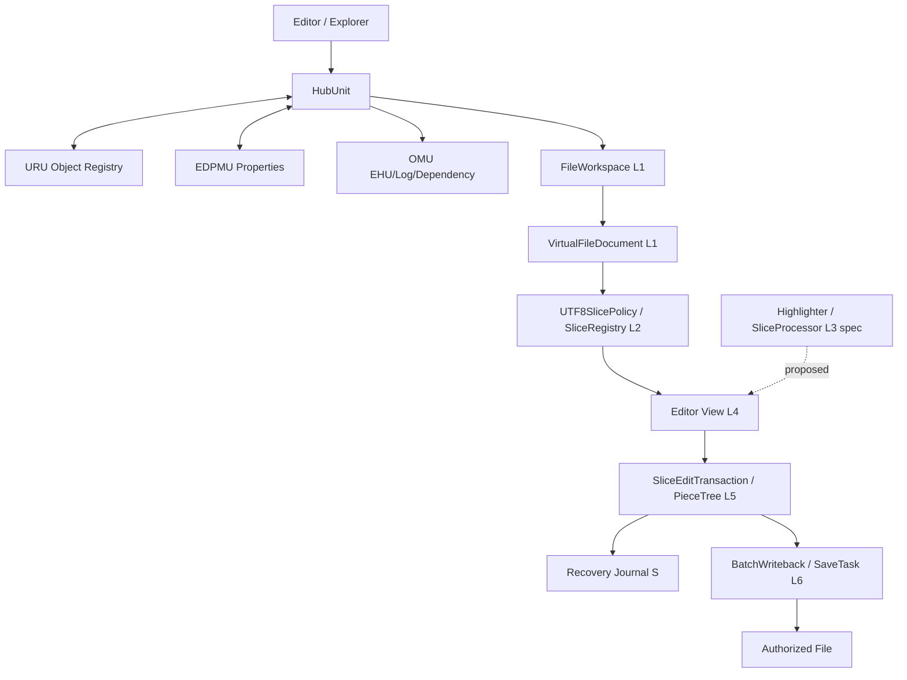

# PLUGIN PR01 — ArcD

## New Objects / Properties
PR01 新增 **0 個正式執行期 Object、0 個 Property**；新增一個獨立、唯讀、離線 `ocda-baseline.mjs` 稽核工具與測試。全域屬性不變。

## Dependency / EventChain
| Flow | Main REQ/REP | Failure | Parallelism |
| --- | --- | --- | --- |
| Open | UI→Workspace.open→Document.load | 403/422 | 不同文件可重疊 |
| Page | Workspace.page→VirtualDoc.page | 400/409 | 同文件需有序 |
| Edit | Document.edit→SliceTransaction.transactDurable→Journal | 409/503 | 同 slice MVCC 序列化 |
| Save | Workspace.save→SaveTask→BatchWriteback→readback | 409/503 | 同 handle 序列化 |
| Restore | SessionRecovery.restore→Workspace/Journals | 403/409/503 | 有序恢復 |
| Future plugin | Hub Service→Provider→validated REP | 403/404/408 | routeVersion 貫穿 REQ/REP |

## EHU matrix
200 = REQ/REP success，201 = registered，400 = invalid，403 = denied，404 = unknown target，409 = stale MVCC，413 = budget，422 = decode/readback，423 = circular wait，429 = scheduler，503 = failure。FAIL 與 EHU 必保留；PASS 可以 1 秒去重。

## Relation Code
00 無互動、10 Request、01 Response、11 雙向；OMU 觀測到的 Dependency 不是授權，必須以 VTE 分別測允許與拒絕行為。靜態分析有假陰性（動態呼叫/Factory），不能拿來代替執行期安全檢查。