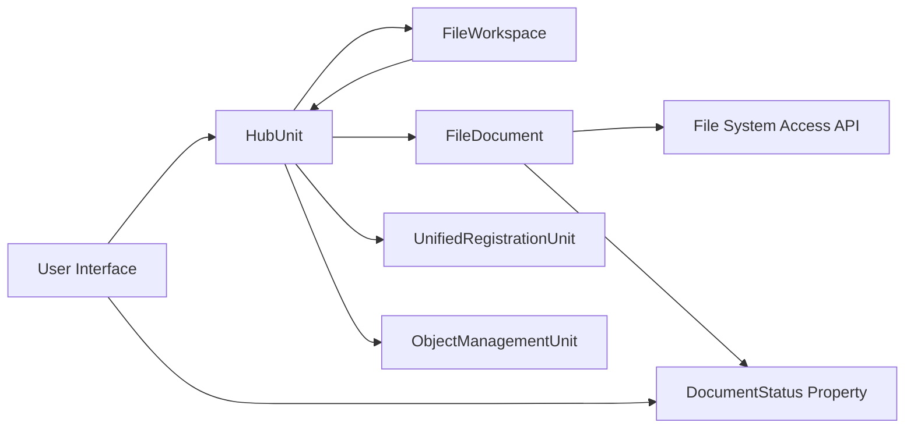

# PR1 Architecture Design

## Objects
- FileWorkspace: document registry, active tab, close lifecycle
- FileDocument: text, disk handle, load/save
- Main UI: tab bar, editor, progress, line numbers
- LinkCore: runtime registration, mediated requests, OMU records

## Properties
- DocumentStatus: shared green / yellow / red / blue status

## Event chain
UI -> HubUnit.request -> FileWorkspace.receive -> HubUnit.request ->
FileDocument.receive -> file picker / FileSystem API -> response -> OMU log.

## Abstract architecture

## EHU table
| Condition | HTTP-style code | Effect |
| --- | --- | --- |
| Request succeeded | 200 | Pass log (1s throttle) |
| Invalid registration | 400 | EHU and refusal |
| Unknown target | 404 | EHU and error response |
| Duplicate ID | 409 | EHU and refusal |
| Exception in receiver | 500 | EHU and error response |

## Limitations
LinkCore units are presently encapsulated in one file; split into
HubUnit / OMU / EDPMU / URU in the next patch. No actual HTTP server is
needed for local logs; codes are HTTP-style. Dynamic relation probes and
VTE are not yet implemented.
