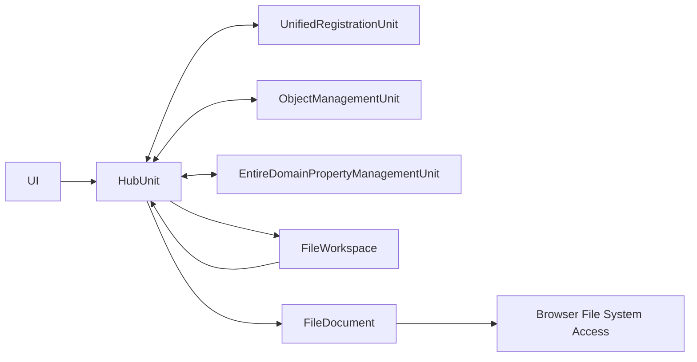
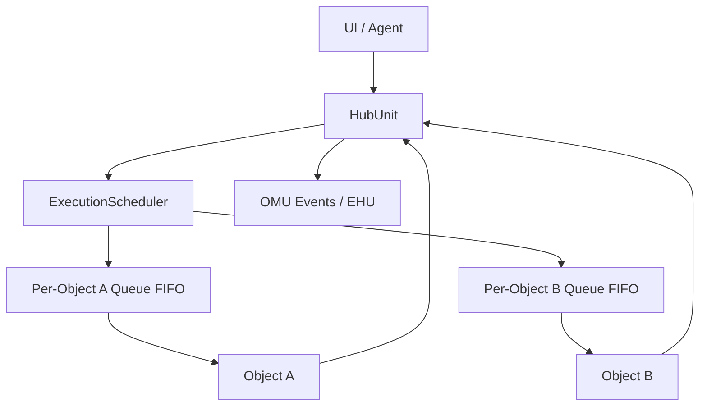
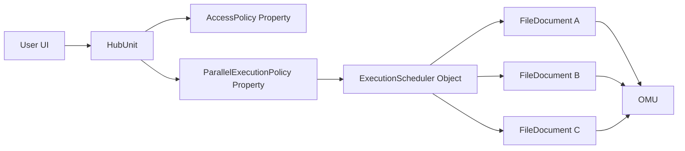

# PR1 — Architecture Design (Patch +2)

## Object / Property inventory
- Object: FileWorkspace — manages tabs and document lifecycle.
- Object: FileDocument — owns text, handle, editing, reading and writing.
- Object: UI — renders editor and status.
- Property: DocumentStatus — shared document state.
- Property: SystemVersion — LinkCore-published version identifier.

## LinkCore
- HubUnit: mediates requests/responses; publishes property changes.
- UnifiedRegistrationUnit: dynamic in-memory object registration;
  optional explicitly trusted factory for missing IDs.
- ObjectManagementUnit: EHU, Log, event IDs, throttling and relation observation.
- EntireDomainPropertyManagementUnit: shared property registry.

## Event chain
1. UI.request -> HubUnit -> URU checks source and target.
2. HubUnit records Request and forwards action.
3. Object.receive handles action and returns a value.
4. HubUnit records Response or EHU; OMU updates dependency observations.

## Diagram

## Relation Code
From source perspective, bit 1 = Request, bit 0 = Response.
00 none; 10 Request only; 01 Response only; 11 both.
Observed edges do not replace access authorization (pending).

## EHU table
| Event | Status | Handling |
| --- | --- | --- |
| Invalid object | 400 | Log EHU |
| Missing registration | 404 | Log EHU, reject |
| Duplicate registration | 409 | Log EHU, reject |
| Successful interaction | 200 | Pass log; 1s cooldown |
| Response exception | 500 | Log EHU, reject |

## Outstanding design items
Public/Protected/Private authorization; standardized User/Agent API;
VTE sandbox; active virtual requests; complete lifecycle logs;
property access mediation (current UI direct import); robust DOM E2E.

## Patch(+3): ExecutionScheduler

### Concurrency rules
- Default active requests: 4; pending queue cap: 1024.
- Same receiver ID: serialized, FIFO; different IDs: overlapping async I/O.
- No blocking locks, no Web Worker threads, no cross-tab synchronization.
- Queue overload: HTTP-style 429 EHU; queued cancellation: 499 EHU.
- Per-operation exceptions: HTTP-style 500 EHU and lock release.
- Lock order/reentrancy is not yet validated; nested same-key requests
  are a known source of deadlock and remain a release blocker.

### Event and lock lifecycle
Hub validates parties -> scheduler queues by receiver ID -> scheduler starts
-> Hub records request -> receiver executes -> Hub records response/EHU
-> scheduler releases key and wakes next request.

## Patch(+4) — updated Object / Property / Event Chain

### New Properties
- AccessPolicy: Public/Protected/Private authorization algorithm.
- ParallelExecutionPolicy: maxConcurrency, maxNested, queue limits,
  object lock key, and pure runnable-task selection logic.

### New Units
- ExecutionScheduler Object: queue/lock lifecycle and scheduling API.
- VirtualTestEnvironment Object: isolated memory-only simulation.
- ObjectContract: validates required OCDA object descriptors.

### Event Chain: file opening
User click -> browser file picker -> UI Request -> HubUnit -> URU lookup
-> AccessPolicy -> scheduler -> Workspace Request -> HubUnit
-> FileDocument Response(load) -> browser File stream
-> OMU Log/EHU -> UI operation progress.

### Event Chain: file saving
User click -> optional Save As picker -> HubUnit -> Workspace
-> HubUnit -> FileDocument -> chunked write -> response
-> OMU Log/EHU -> green/yellow/red status.

### Parallelism

### Updated EHU status table
| Code | Meaning |
| --- | --- |
| 200 | Completed operation |
| 201 | Registered Object or Property |
| 400 | Invalid contract or request |
| 403 | Access denied |
| 404 | Unregistered resource |
| 409 | Registration conflict |
| 413 | File exceeds PR1 memory budget |
| 423 | Circular nested wait |
| 429 | Queue or nested execution capacity reached |
| 499 | Queued operation cancelled |
| 500 | Object response exception |

### Runtime registry / inheritance
- URU lists Object IDs, including fully qualified SubObject paths.
- EDPMU owns Property values and owner metadata.
- A Child path may inherit a parent's registered Properties.
- Hub performs visibility checks before protected reads.
- Reload clears runtime registration; source code registers again.

### Known architectural risks
- Calls from unrelated JS can currently claim another source Object ID.
  A robust external Agent boundary must authenticate origin and capability.
- Request context does not yet include an immutable trace-parent token;
  event tree linkage is inferred from source/target edges.
- CPU-heavy code runs on the main JS thread until Worker support is added.

## Patch(+5) original UI integration
Legacy source: `ClusterOpt/Program/src/style.css` and original
`#app/#tabs/#workspace/#editorPane/#gutter/footer` structure.
PR1 `main.js` maps these legacy elements to independent FileWorkspace
and FileDocument objects; UI remains a consumer of LinkCore APIs.

### E2E Event Chain
Click File menu -> browser picker (user gesture) -> authorized handle
-> UI Request -> HubUnit -> Workspace -> FileDocument -> File API
-> EHU/Log -> status and progress -> visual assertion.

### Verification boundary
Playwright uses mock File System Access handles, while Node tests use
in-memory fake handles and Blob streams. Native permission prompts and
OS-specific file changes still require actual browser manual tests.

## Patch(+6) UserAPI and AgentAPI security
An explicit `origin="user"` or `origin="agent"` on a Request
is validated against the destination Object's declared allowlist.
An undeclared action generates EHU 403 before execution.

UI file menu and tab controls -> HubUnit -> FileWorkspace.
UI edit events -> HubUnit -> FileDocument.
Other internal Object -> Object requests use the internal channel.

This is not yet a cryptographic identity mechanism; untrusted external
Agent transports must authenticate their source/capabilities separately.
