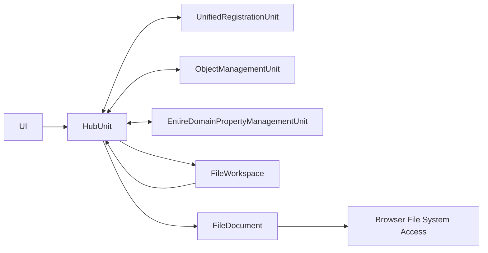
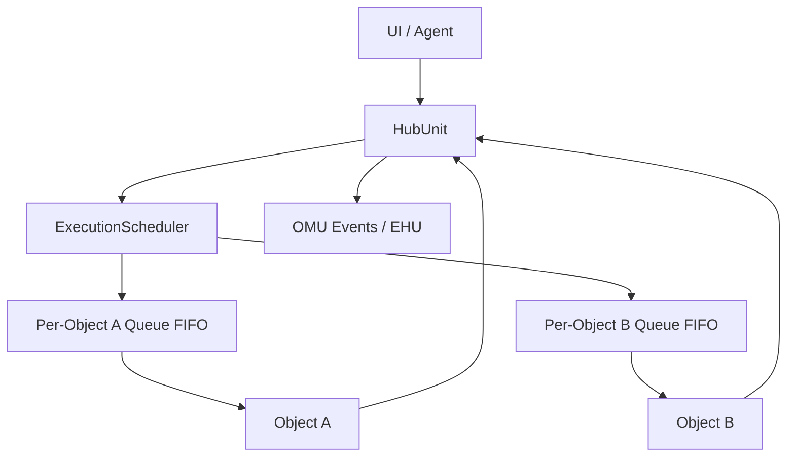

# PR1 — Architecture Design (Patch +2)

## Object / Property inventory
- Object: FileWorkspace — manages tabs and document lifecycle.
- Object: FileDocument — owns text, handle, editing, reading and writing.
- Object: UI — renders editor and status.
- Property: DocumentStatus — shared document state.
- Property: SystemVersion — LinkCore-published version identifier.

## LinkCore
- HubUnit: mediates requests/responses; publishes property changes.
- UnifiedRegistrationUnit: dynamic in-memory object registration;
  optional explicitly trusted factory for missing IDs.
- ObjectManagementUnit: EHU, Log, event IDs, throttling and relation observation.
- EntireDomainPropertyManagementUnit: shared property registry.

## Event chain
1. UI.request -> HubUnit -> URU checks source and target.
2. HubUnit records Request and forwards action.
3. Object.receive handles action and returns a value.
4. HubUnit records Response or EHU; OMU updates dependency observations.

## Diagram

## Relation Code
From source perspective, bit 1 = Request, bit 0 = Response.
00 none; 10 Request only; 01 Response only; 11 both.
Observed edges do not replace access authorization (pending).

## EHU table
| Event | Status | Handling |
| --- | --- | --- |
| Invalid object | 400 | Log EHU |
| Missing registration | 404 | Log EHU, reject |
| Duplicate registration | 409 | Log EHU, reject |
| Successful interaction | 200 | Pass log; 1s cooldown |
| Response exception | 500 | Log EHU, reject |

## Outstanding design items
Public/Protected/Private authorization; standardized User/Agent API;
VTE sandbox; active virtual requests; complete lifecycle logs;
property access mediation (current UI direct import); robust DOM E2E.

## Patch(+3): ExecutionScheduler

### Concurrency rules
- Default active requests: 4; pending queue cap: 1024.
- Same receiver ID: serialized, FIFO; different IDs: overlapping async I/O.
- No blocking locks, no Web Worker threads, no cross-tab synchronization.
- Queue overload: HTTP-style 429 EHU; queued cancellation: 499 EHU.
- Per-operation exceptions: HTTP-style 500 EHU and lock release.
- Lock order/reentrancy is not yet validated; nested same-key requests
  are a known source of deadlock and remain a release blocker.

### Event and lock lifecycle
Hub validates parties -> scheduler queues by receiver ID -> scheduler starts
-> Hub records request -> receiver executes -> Hub records response/EHU
-> scheduler releases key and wakes next request.
