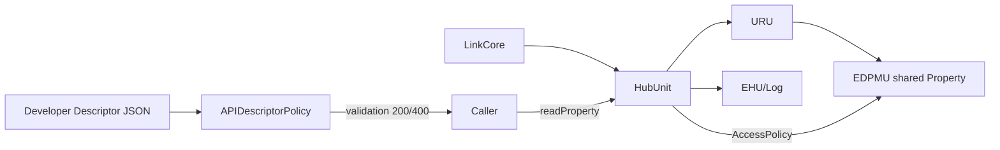
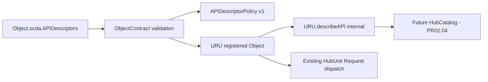
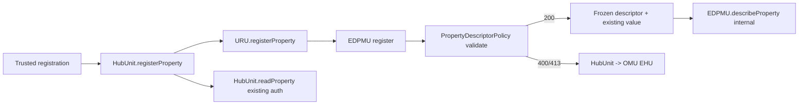
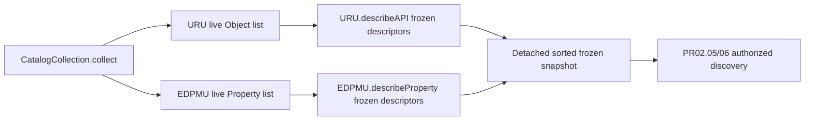
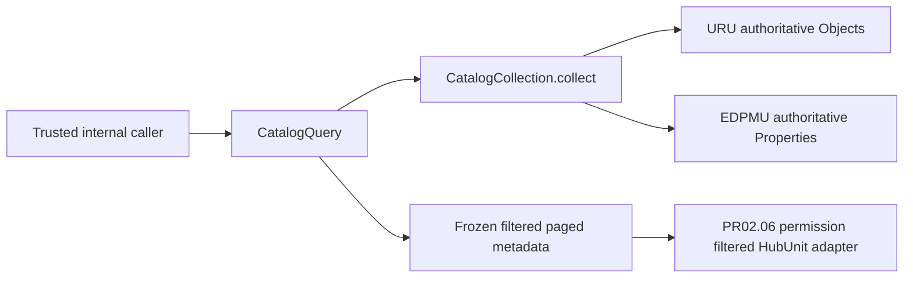
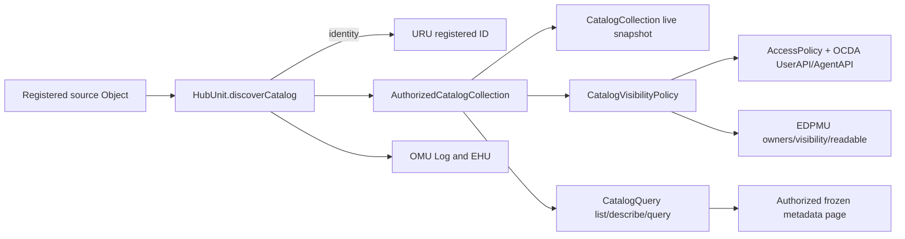
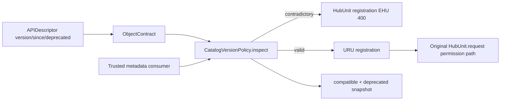
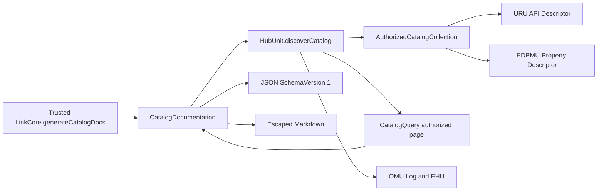

# PLUGIN PR02 — ArcD.md
## Object / Property Changes
- New immutable Property: APIDescriptorPolicy
- Owner: LinkCore; visibility Public; metadata validator only
- New Object: none; no duplicate URU registry
- Existing LinkCore registers through HubUnit, EDPMU remains authoritative

## EventChain
1. LinkCore Constructor → HubUnit.registerProperty(APIDescriptorPolicy)
   → URU → EDPMU; registration result logged by OMU.
2. Registered audit object → LinkCore.readProperty → HubUnit
   → AccessPolicy → EDPMU; 200 on successful read.
3. Client calls validator locally on immutable Property → 200 valid,
   400 invalid. Validation isn't a cross-Object Request and cannot
   bypass HubUnit authorization.
4. Existing Editor/Save/Recovery flows unchanged.

## Relation Matrix
LinkCore → HubUnit = Request; HubUnit ↔ URU/EDPMU/OMU via
preexisting controlled internal calls. No new cross-Object route.
No data race with MVCC or SaveTask. New operation is synchronous bounded
validation, not parallel worker execution.

## EHU
HubUnit missing caller/property/visibility failures remain recorded as
EHU 403/404. Invalid descriptor returns 400 locally; PR02.09 will map
catalog endpoint errors into EHU. Do not invent EHU for local pure logic.

## PR02.01 Deliverable Freeze
The descriptor result is deeply frozen and detached from caller input,
so future service registries can read stable metadata. The Property
registration remains in one LinkCore location; it neither permits
cross-Object calls nor changes any existing REQ/REP route.

## PR02.02 — URU internal descriptor projection

Contract validation occurs at actual URU registration, not a mock Catalog.
Malformed/duplicate/deceptive descriptors are rejected with registration
EHU 400. This subPR adds no browser-facing unrestricted API; the external
Catalog in PR02.05/06 will filter source visibility and authority.

## PR02.02 Gate
The internal URU validated metadata index is available only to trusted
internal callers. No anonymous public Catalog was exposed. Runtime
registration, response and unregister reflect a single URU truth.
Validated on exact-head Node and Chromium tests; no new routing bypass.

## PR02.03 — Single-authority Property Descriptor

New Property: PropertyDescriptorPolicy, LinkCore-owned and Public (schema
validator only). No new Object or duplicated Property registry.

EventChain:
1. Hub registration -> URU -> EDPMU -> validator -> single record (201).
2. Bad metadata or mismatched name/owner/visibility -> 400/413 + EHU,
   no partial register and no duplicate record.
3. Trusted describeProperty -> detached frozen metadata or null/404.
4. Actual value read still traverses HubUnit authorization (200/403/404).
Relations: existing HubUnit-URU/EDPMU/OMU edges reused. No newly
permitted cross-Object relation. Metadata is not a capability token.
Distinct properties can register independently; same name is unique.

## PR02.04 — Internal Catalog Collection

No new global Property, Object route, duplicated mutable registry,
EHU side effects or authorization capability. CatalogCollection is an
internal LinkCore-owned helper. Registration lifecycle remains in
HubUnit/URU/EDPMU. PR02.04 never exposes the snapshot on window.Cluster.
EventChain: runtime registration -> underlying authoritative registry;
collect -> live lookup -> immutable snapshot; runtime unregister ->
next collect excludes removed entries. Lookup errors return status and
never synthesize metadata. No asynchronous shared snapshot cache or
scheduler dependence; read-only, linear work bounded to 4096 entries.

## PR02.05 — Internal Discovery

CatalogQuery has no register/update/execute API. No second mutable index.
EventChain: internal selector -> validation 400 -> collect 200/413 ->
filter stable sort -> list/query page 200, describe 200/404/409.
No direct HubUnit crossing or EHU for pure local search; external caller
must use PR02.06 authorized HubUnit route to trigger EHU on 403.
No new Object/Property registration or Dependency edge.

## PR02.06 — Authorized Catalog Projection

Relation: no new remote Object API; LinkCore -> HubUnit internal call,
HubUnit -> URU and EDPMU existing dependencies and Policy read.
No new execution route or Property mutation. Filter precedes query
counts to avoid pagination-based disclosure. EventChain:
1. Caller source lookup registered: 404 EHU if absent (no factory).
2. Validate origin user/agent, command; 400 EHU if invalid.
3. Collect live bounded metadata, enforce AccessPolicy and exposure.
4. Query filtered metadata; 200 Log, 404/409/400 EHU on failure.
5. Actual invocations still require normal HubUnit.request authorization.
EHU errors are metadata only, no handler called on deny.

PR02.06 repair: CatalogCollection checks Object.ocda.APIDescriptors
before invoking strict URU.describeAPI. Legacy Objects lacking the
contract produce zero API metadata but still participate as registered
Hub callers. No new registry and no change to actual Request routing.

## PR02.07 — Version Compatibility Property

New Property CatalogVersionPolicy registered once in LinkCore.
No new Object, registry or request handler. EventChain: registration
calls strict APIDescriptor validation, then since<=version; invalid
contract returns EHU 400 and does not register. Consumer calls pure
inspect and receives 200 compatibility/deprecation metadata or 400.
No route through policy can authorize an action. Parallel independent
checks have no mutation and no dependency edge except existing Hub.

## PR02.08 — Authorized Documentation Event Chain

Single shared Property CatalogDocumentation registered via HubUnit.
No new executable Object/API, new routing, additional registry or disk
access. Required source identity and origin stay in HubUnit; missing
caller generates EHU 404. Invalid format returns pure 400, oversized
output 413 without partial document. Schema + descriptor metadata only;
never expose live Property values or privileged Object handlers.
Flow: validate format -> authorized paged discovery of APIs and
Properties -> deterministic canonical order -> escape/render -> byte
budget -> immutable result 200. No mixed-visibility raw snapshot.
