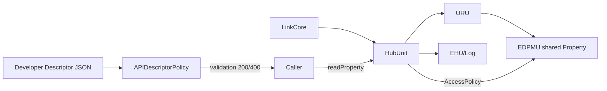

# PLUGIN PR02 — ArcD.md
## Object / Property Changes
- New immutable Property: APIDescriptorPolicy
- Owner: LinkCore; visibility Public; metadata validator only
- New Object: none; no duplicate URU registry
- Existing LinkCore registers through HubUnit, EDPMU remains authoritative

## EventChain
1. LinkCore Constructor → HubUnit.registerProperty(APIDescriptorPolicy)
   → URU → EDPMU; registration result logged by OMU.
2. Registered audit object → LinkCore.readProperty → HubUnit
   → AccessPolicy → EDPMU; 200 on successful read.
3. Client calls validator locally on immutable Property → 200 valid,
   400 invalid. Validation isn't a cross-Object Request and cannot
   bypass HubUnit authorization.
4. Existing Editor/Save/Recovery flows unchanged.

## Relation Matrix
LinkCore → HubUnit = Request; HubUnit ↔ URU/EDPMU/OMU via
preexisting controlled internal calls. No new cross-Object route.
No data race with MVCC or SaveTask. New operation is synchronous bounded
validation, not parallel worker execution.

## EHU
HubUnit missing caller/property/visibility failures remain recorded as
EHU 403/404. Invalid descriptor returns 400 locally; PR02.09 will map
catalog endpoint errors into EHU. Do not invent EHU for local pure logic.
