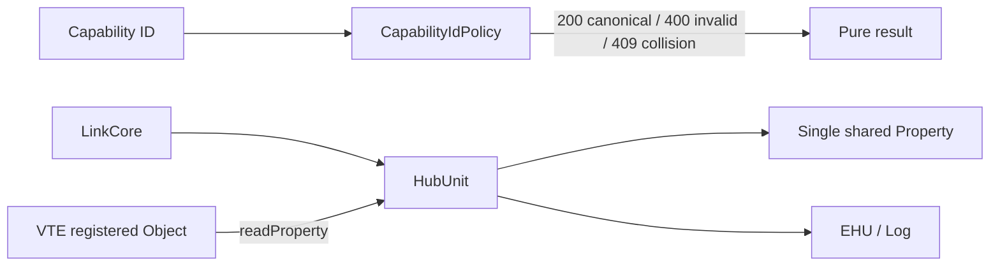
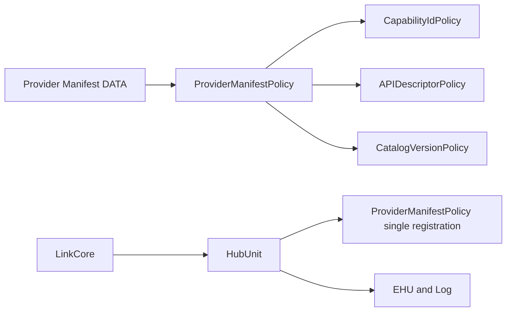

# PLUGIN PR03 — ArcD.md
## PR03.01 Object / Property mapping
New Property: CapabilityIdPolicy (LinkCore owned, Public, immutable).
New Object: none. Future ServiceRegistry remains unimplemented.

EventChain:
1. LinkCore initialization -> HubUnit.registerProperty -> URU/EDPMU
   single immutable registration, OMU logs result.
2. VTE registered audit Object -> HubUnit.readProperty ->
   AccessPolicy / EDPMU -> 200 and OMU Log.
3. Pure validate / checkUnique -> 200 / 400 / 409 result. No cross-
   Object calls or EHU for local pure operations; caller does not
   acquire permission from the validation outcome.
4. Existing Cluster.api and editor Request/Response remain unchanged.

Relation matrix: audit caller -> HubUnit 10 Request; result 01 Response;
HubUnit-URU/EDPMU/OMU relationships unchanged, zero new dependencies.
No route changes, no MVCC/writeback locks, no test-only user UI.

## PR03.02 — Provider Manifest validation
New Property: ProviderManifestPolicy, owner LinkCore, Public.
New Object: none. ServiceRegistry and Provider registration remain TODO.

EventChain: LinkCore init -> Hub.registerProperty -> URU/EDPMU -> OMU.
A registered audit caller -> Hub.readProperty -> AccessPolicy ->
EDPMU returns shared pure validator (200, Log). Local validate
returns immutable data snapshot (200) or 400; pure validation is not a
cross-Object Request and does not write an EHU for every rejected datum.
Relation: registered caller -> Hub controlled Property read, existing
10 Request / 01 Response pattern, no new REQ routes. Validation never
triggers factories, provider execution, change of shared Property, or
extra Object dependency. Manifest permission strings are descriptive
claims awaiting later URU/AccessPolicy checks, NOT tokens or grants.
