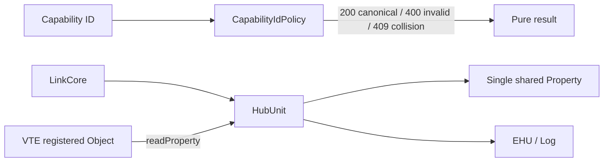
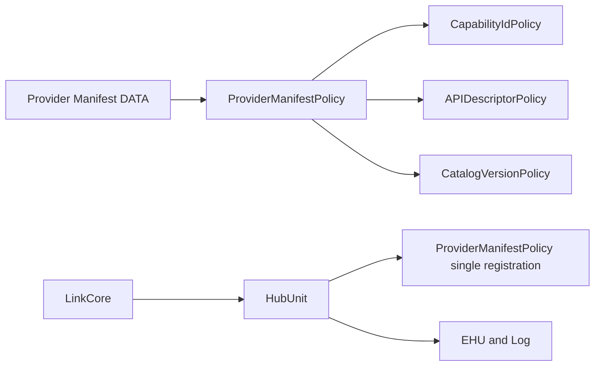
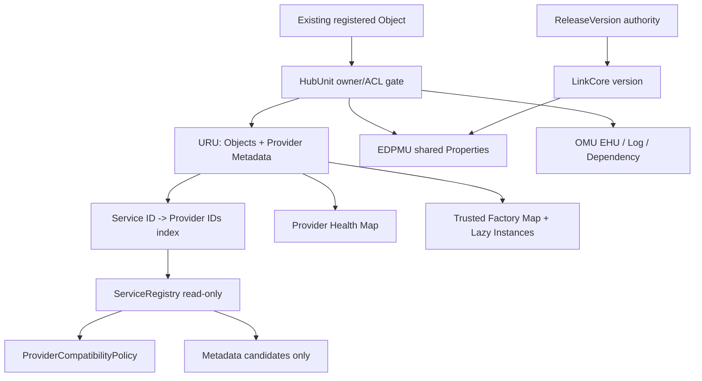

# PLUGIN PR03 — ArcD.md
## PR03.01 Object / Property mapping
New Property: CapabilityIdPolicy (LinkCore owned, Public, immutable).
New Object: none. Future ServiceRegistry remains unimplemented.

EventChain:
1. LinkCore initialization -> HubUnit.registerProperty -> URU/EDPMU
   single immutable registration, OMU logs result.
2. VTE registered audit Object -> HubUnit.readProperty ->
   AccessPolicy / EDPMU -> 200 and OMU Log.
3. Pure validate / checkUnique -> 200 / 400 / 409 result. No cross-
   Object calls or EHU for local pure operations; caller does not
   acquire permission from the validation outcome.
4. Existing Cluster.api and editor Request/Response remain unchanged.

Relation matrix: audit caller -> HubUnit 10 Request; result 01 Response;
HubUnit-URU/EDPMU/OMU relationships unchanged, zero new dependencies.
No route changes, no MVCC/writeback locks, no test-only user UI.

## PR03.02 — Provider Manifest validation
New Property: ProviderManifestPolicy, owner LinkCore, Public.
New Object: none. ServiceRegistry and Provider registration remain TODO.

EventChain: LinkCore init -> Hub.registerProperty -> URU/EDPMU -> OMU.
A registered audit caller -> Hub.readProperty -> AccessPolicy ->
EDPMU returns shared pure validator (200, Log). Local validate
returns immutable data snapshot (200) or 400; pure validation is not a
cross-Object Request and does not write an EHU for every rejected datum.
Relation: registered caller -> Hub controlled Property read, existing
10 Request / 01 Response pattern, no new REQ routes. Validation never
triggers factories, provider execution, change of shared Property, or
extra Object dependency. Manifest permission strings are descriptive
claims awaiting later URU/AccessPolicy checks, NOT tokens or grants.

## PR03.03–03.10 implementation architecture

### Object/Property mapping
- Existing Object authority: URU (not ServiceRegistry).
- Existing security gate: HubUnit (all caller-checked operations).
- Existing log authority: OMU.
- Existing shared Property authority: EDPMU.
- New Properties: ProviderSharedPropertyPolicy, ProviderFactoryPolicy,
  ProviderCompatibilityPolicy, ProviderHealthPolicy, each standalone and
  registered exactly once by HubUnit in LinkCore.
- New read-only helper: ServiceRegistry, no independent Object map.
- New release authority: ReleaseVersion.js (SystemVersion projection).
- No external Provider mutation endpoint on Cluster.api, no unsafe
  installer and no active route table.

### Event Chains and negative cases
- registration source -> Hub owner gate -> URU check -> 201 Log;
  403 impersonation, 404 unknown, 409 collision all EHU
- property write source -> Hub Provider ownership+claim+EDPMU owner
  -> 200 Log or 403/404 EHU
- lazy factory source -> Hub owner gate -> URU trusted code -> 201
  instance once; error 500 EHU, unknown 404 EHU
- enable/disable/dispose -> Hub -> URU and OMU 200 or EHU; does
  not remove unrelated Providers, OR overwrite Manifest
- health report -> Hub -> URU transition -> 503/504 incident EHU,
  429 cooling EHU, return 200 for accepted transition
- VTE registered A -> Hub.request -> B.receive -> Hub REP to A;
  OMU A->B 10 (request), B->A 01 (response);
  unrelated Object pair remains 00, repeated two-way links may
  aggregate to 11. No Provider invocation from Catalog/Service lookup.

### Failure/scale risk
<=32 provided Services/manifest, <=64 declared dependencies,
<=32KiB Manifest, one URU index entry per provided service.
Synchronous trusted Factory only, no concurrency proof claimed.
PR05 adds inflight drain and atomic route switching, PR06 untrusted
sandbox provenance/isolation. Avoid mutating editor/Slice/SaveTask path.
