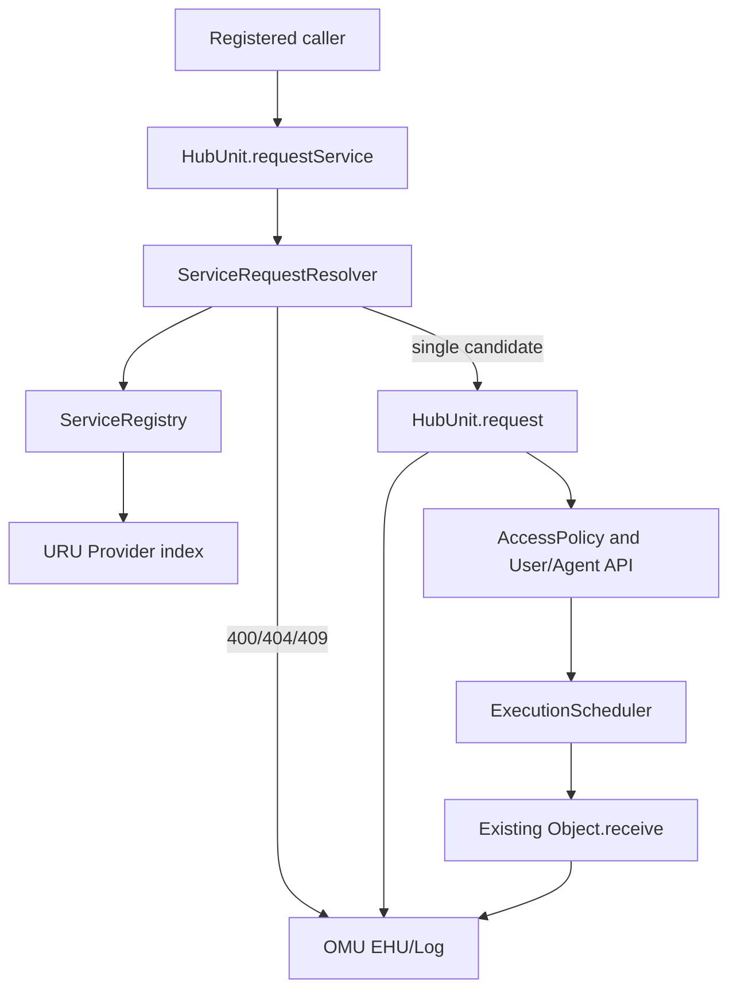

# PLUGIN PR04 — ArcD

## Object/Property table
| Component | Kind | Role | Owner |
| --- | --- | --- | --- |
| ServiceRequestResolver | LinkCore helper | read-only resolver | LinkCore |
| ServiceRegistry | existing projection | available Providers | URU |
| URU | existing registry | Object/Provider authority | LinkCore |
| HubUnit | existing gateway | REQ/REP/ACL/schedule | LinkCore |
| OMU | existing observer | EHU/Log/Dependency | LinkCore |
| EDPMU | existing registry | shared Properties | LinkCore |

No new shared Property or separately registered Object is introduced.

## EventChain
1. Verify registered source (404 / EHU otherwise).
2. Validate canonical Service ID/action (400), query active Providers.
3. Resolve none 404, multiple 409; EHU and no dispatch.
4. Resolve exactly one Object/action; log selected Provider.
5. Delegate to HubUnit.request with original source/options/payload.
6. Existing Hub checks UserAPI/AgentAPI and AccessPolicy, schedules
   dispatch, logs Request and Response; failure remains EHU.
7. OMU records Caller->Target=10, Target->Caller=01 when successful.

## Route invariants
No silent Provider choice, no implicit factory execution, no
authorization or origin bypass, no change to legacy target-ID semantics.
Full route generation / atomic replacement are future PR04/PR05 tasks.
