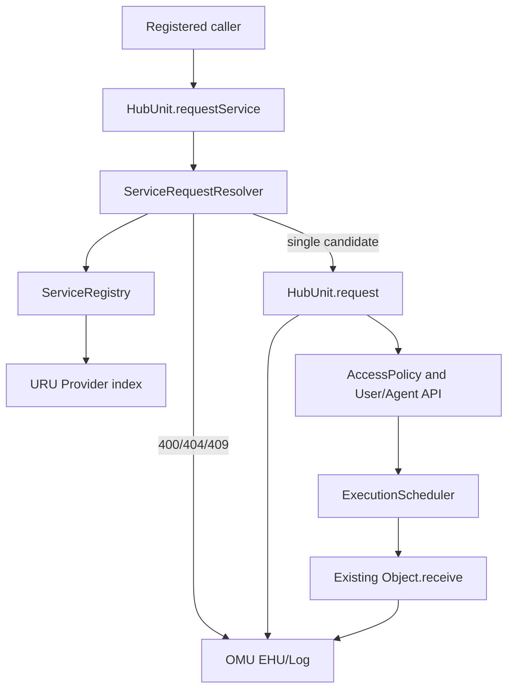
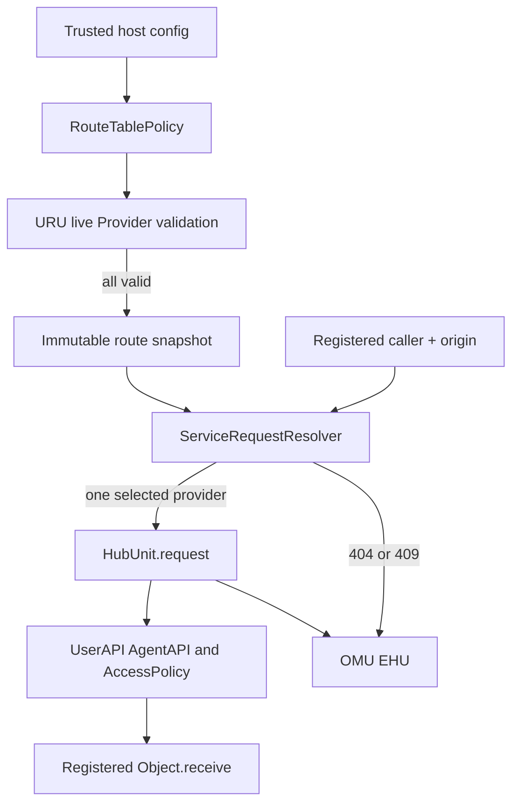
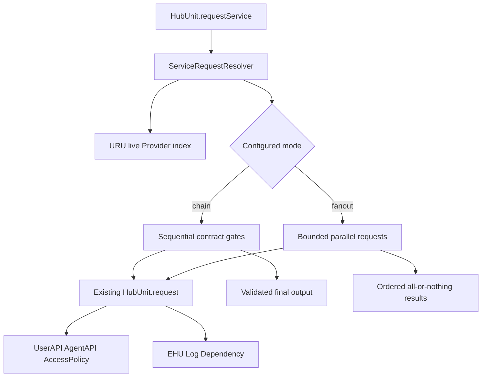

# PLUGIN PR04 — ArcD

## Object/Property table
| Component | Kind | Role | Owner |
| --- | --- | --- | --- |
| ServiceRequestResolver | LinkCore helper | read-only resolver | LinkCore |
| ServiceRegistry | existing projection | available Providers | URU |
| URU | existing registry | Object/Provider authority | LinkCore |
| HubUnit | existing gateway | REQ/REP/ACL/schedule | LinkCore |
| OMU | existing observer | EHU/Log/Dependency | LinkCore |
| EDPMU | existing registry | shared Properties | LinkCore |

No new shared Property or separately registered Object is introduced.



## EventChain
1. Verify registered source (404 / EHU otherwise).
2. Validate canonical Service ID/action (400), query active Providers.
3. Resolve none 404, multiple 409; EHU and no dispatch.
4. Resolve exactly one Object/action; log selected Provider.
5. Delegate to HubUnit.request with original source/options/payload.
6. Existing Hub checks UserAPI/AgentAPI and AccessPolicy, schedules
   dispatch, logs Request and Response; failure remains EHU.
7. OMU records Caller->Target=10, Target->Caller=01 when successful.

## Route invariants
No silent Provider choice, no implicit factory execution, no
authorization or origin bypass, no change to legacy target-ID semantics.
Full route generation / atomic replacement are future PR04/PR05 tasks.

## PR04.02 — RouteTablePolicy
New independent property policy module:
`Implementation/property/RouteTablePolicy.js` (NOT EDPMU-registered).
Input: untrusted declarative data. Output: 400 or immutable canonical
Route Table snapshot. It never writes HubUnit, URU or EDPMU.

```mermaid
flowchart LR
  Manifest[Route Table data] --> Policy[RouteTablePolicy.validate]
  Policy -->|200| Frozen[Immutable snapshot only]
  Policy -->|400| Reject[Reject without side effects]
  Frozen -. future PR04.03 .-> Hub[HubUnit routing]
  Hub --> URU[URU providers]
```

EventChain: local validation only; no Request or Response dispatch, no
new Dependency edge, no EHU mutation. Future callers must use HubUnit
for route operations, permission checking and EHU/Log; this pure policy
cannot authorize its own input. Relation Code 00 for validation itself.

## PR04.03 — Replace routing
Object/Property: no new Object or EDPMU Property. ServiceRequestResolver
reads an immutable HubUnit-owned RouteTablePolicy snapshot; URU is the
single live Provider authority. HubUnit retains all Request/Response,
AccessPolicy, User/Agent API checks and OMU records.



Event Chain:
1. Host configuration validates RouteTablePolicy; rejects 400/404
   without mutation, records EHU. On success swaps one snapshot.
2. Incoming REQ checks caller existence and explicit origin.
3. Matching replace routes filtered by Service/action/origin/caller.
4. Highest priority resolves live URU Provider. A disabled or missing
   selected Provider returns 404; no silent reassignment.
5. Existing HubUnit.request enforces ACL, scheduler, EHU/Log and REP.
6. Dependencies are still Request=10 and Response=01 on success.
No new Event ID allocator or independent route authority.

Separate future PR05 routeVersion/CAS/draining and PR04.08 external
permission gate; this is a trusted in-process configuration, not a
sandbox boundary or untrusted plugin administration API.

## PR04.04–05 Dataflow and ownership


No new Object registry or shared EDPMU Property. RouteContractPolicy
is pure and local to LinkCore. Each hop is a full request+response;
the registered original caller remains the source, never an arbitrary
Provider-supplied identity. Chain validates per-hop input/output; fanout
checks each input before dispatch and each output after results.
Failures 422/502 record EHU; ACL failures retain original 403.
The scheduler is unchanged, so concurrency is asynchronous only.
