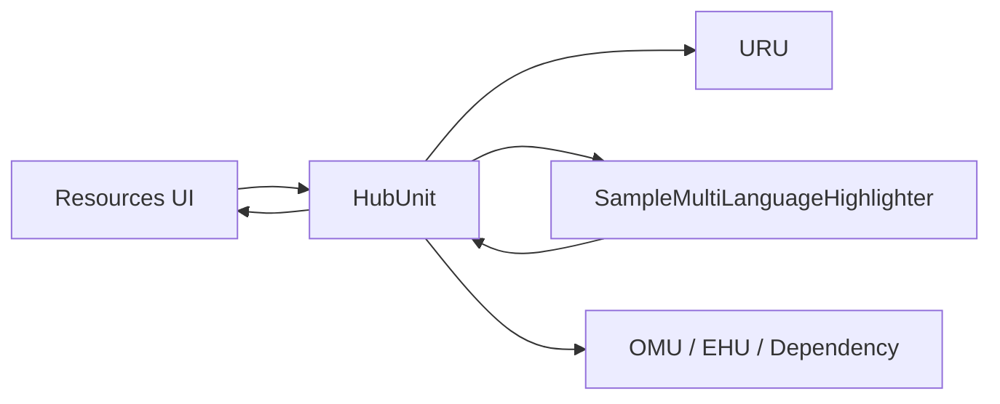

# ArcD — OCDA sample highlighter

## Objects
SampleMultiLanguageHighlighter:
- EHU/Log: HubUnit + OMU
- Request: highlight
- Response: result returned to requester
- UserAPI: highlight
- AgentAPI: none
- Property: none (language grammar is immutable module-local data)
- Program: bounded regex tokenizer

Provider: cluster.sample.multilang-highlighter
Service: editor.syntax.highlight, action: highlight

## Event chain
Resources mount -> same-origin reviewed import -> Object registration
-> HubUnit.registerProvider -> URU Manifest validation.
Resources sample test -> HubUnit.requestService(ui, service, highlight)
-> AccessPolicy -> Object.receive -> OMU dependency and logs
-> Response -> Resources preview.

## Relation / EHU cases
- 201 registered, 200 idempotent (re-mount)
- 403 unsupported path (UI blocks before execution)
- 404 missing provider on premature test
- 413 oversized text (receive throws status, Hub logs EHU)
- 409 Object registration conflict or failed Provider registration
- 500 import or runtime failure (visible mount error)

## Parallel evaluation
Tokenization is pure and stateless. Independent slices are parallelizable,
but **currently run in-process** via existing Hub scheduling. No new
Worker isolation or privileged code execution is introduced.

## Diagram

