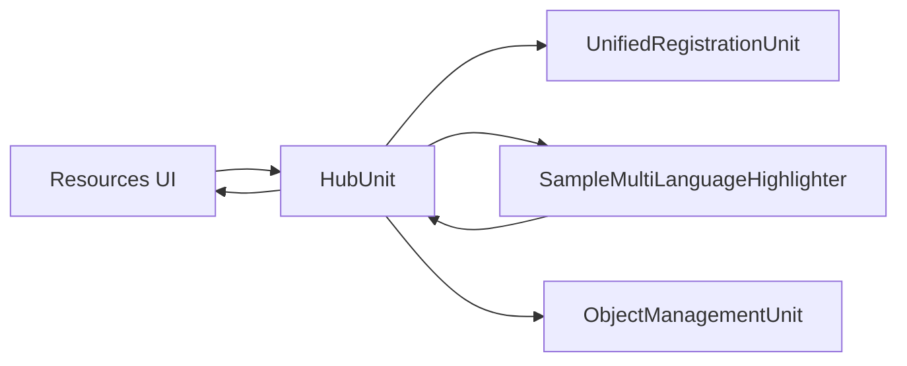

# PR11 ArcD — Object/Property/Event Chain

## Object
SampleMultiLanguageHighlighter
- Request: highlight
- Response: syntax token data
- User API: highlight
- Agent API: none
- Property: none; static grammar constants remain module-local
- Program: bounded source-preserving tokenizer
- EHU/Log: existing HubUnit and OMU; no independent log store

Provider ID: cluster.sample.multilang-highlighter
Service: editor.syntax.highlight
Route: Resources UI -> LinkCore.requestService -> HubUnit
 -> URU/ServiceRegistry -> Object.receive -> OMU -> Resources preview

## Relation codes
UI -> sample Object: 10 (Request)
sample Object -> UI: 01 (Response)
HubUnit <-> sample Object: 11 (routed Request/Response)
No direct cross-object Property writes.

## EventChain cases
| Case | Request | Expected result | EHU / log |
| --- | --- | --- | --- |
| Mount | trusted sample path | 201 registration | Log |
| Repeat | same Object + Provider | 200 already mounted | no duplicate |
| Unknown path | path not allowlisted | 403 blocked | UI rejection |
| Highlight | valid text | 200 + tokens | Request/Response Log |
| Oversize | text beyond budget | 413 | EHU |
| Conflict | Object ID occupied | 409 | reject |
| Provider reject | invalid manifest/contract | 400 | URU reject / rollback |
| Missing service | call before mounting | 404 | EHU |

## Parallel model
Object exposes highlight API as hand; immutable language-token algorithms
are the brain. Each input is independent and can be scheduled by slice.
Do not claim true thread-level parallelism until Worker implementation
and benchmarks demonstrate it.

