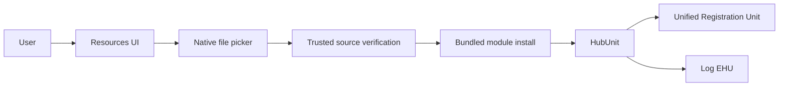
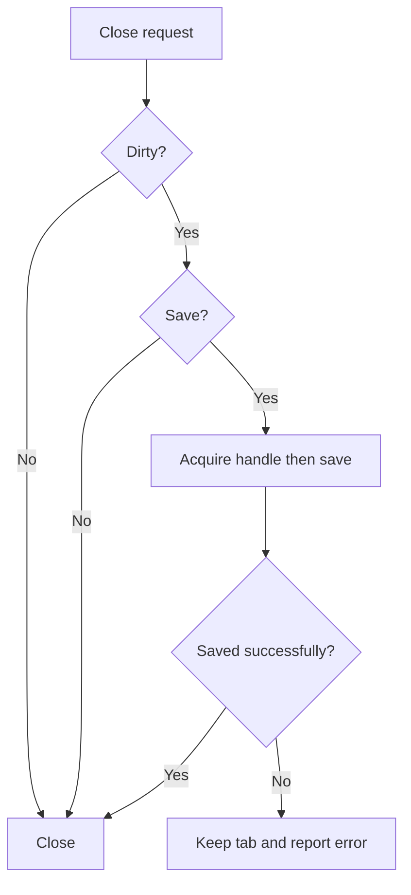

# PR12 ArcD — Objects, Properties, EventChain

## Existing objects
FileWorkspace:
- Request: close, closeAll, closeMany (existing APIs)
- Parameters: optional saveDecision and saveHandles for UI-origin
  requests. No new endpoint or global mutable state.
- On discard: unregister selected FileDocument Objects and refresh.
- On save: persist all selected dirty documents before unregistering;
  failure leaves remaining tabs intact.

Resources UI:
- Downloadable catalogue of reviewed packages.
- Search filters catalogue, not URU's installed Provider list.
- Mount click -> native file chooser -> source verification ->
  import reviewed bundled module -> install(core) -> URU registration.
- No arbitrary local JavaScript execution.

HubUnit/URU/OMU:
- Unchanged registration and REQ/REP authority.
- Neither plugins nor manifests can escalate route privileges.

## EventChain

## File closing

## Dependency and isolation
- UI -> FileWorkspace Request: 10; Workspace -> Document Request: 10.
- Document -> Workspace Response: 01; Workspace -> UI Response: 01.
- Hub/registered Objects REQ+REP: 11, existing OCDA event handling.
- No new globally shared property; Language strings updated in
  existing registered Language catalog.

## EHU conditions
- Invalid file name/size: 400, UI refusal.
- Locally altered JS: 403, blocked before script execution.
- Hosted package unavailable: 503, no installation.
- Save permission denied: 403, tabs retained.
- File picker cancelled: operation abandoned, tabs retained.
- Write failure: EHU via underlying FileDocument/Hub, tabs retained.
