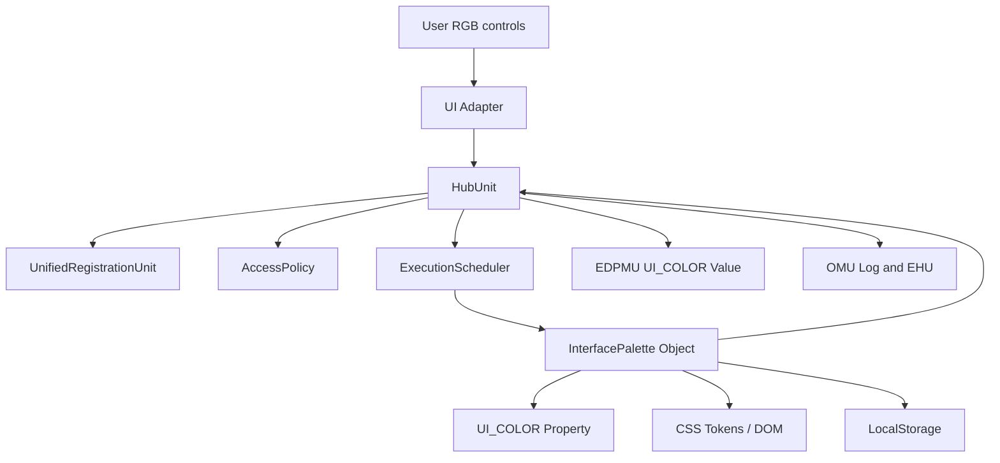

# PR2 ArcD — Patch(+1)

## New Object
`InterfacePalette`:
- Request/Response: get, set, restore
- UserAPI: get, set, restore
- AgentAPI: get only
- Property: UI_COLOR
- EHU/Log: LinkCore → OMU
- Program: immutable snapshot, CSS publication, persistence

## New Property
`UI_COLOR`:
- RGB validator, hexadecimal conversion, CSS token derivation
- Registered once in EDPMU by LinkCore
- Shared publicly with any registered UI Object
- Derived tokens: background/surface/panel/control/hover/border/text/
  muted/editor/gutter/accent/text-on-surface/text-on-panel/
  text-on-control

## New UI adapter
`Implementation/main/palette-ui.js`: DOM-only event wiring and
HubUnit Request routing, keeping original ClusterOpt palette markup.

## Diagram

## EHU
| Code | Example | Handling |
| --- | --- | --- |
| 200 | Valid RGB change | Log PASS / Response |
| 400 | RGB out of bounds | Log EHU; keep old value |
| 403 | Agent set action | Log EHU; deny |
| 404 | Unknown palette object | Log EHU; deny |
| 503 | Storage unavailable | EHU, keep memory value |

## Relationship Tests
RT01: UI → Hub → Palette.get PASS
RT02: UI → Hub → Palette.set PASS
RT03: UI → Palette invalid RGB FAIL(400)
RT04: Agent → Palette.set FAIL(403)
RT05: Palette → Hub → EDPMU(UI_COLOR) PASS
RT06: Reload → Palette restores saved value PASS
RT07: Browser legacy menu/modal + RGB events PASS
RT08: CSS colors rendered from a single palette PASS

## Parallelization
RGB updates are short operations and must serialize by the single
`InterfacePalette` Object key, rather than run in parallel and reorder.
Other independent Object operations may run concurrently with palette.
Algorithm is owned by the UI_COLOR Property; routing/scheduling by Objects.
