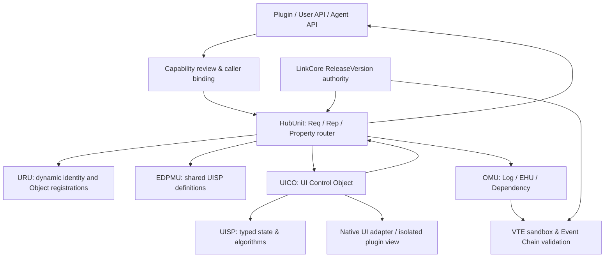

# PR23 ArcD — UICO / UISP Architecture Design
Status: DRAFT · 2026-11-19 · No code claimed implemented

## 1. Logical architecture

UICO owns *authorized control operations*; UISP owns *declarative reusable state and validation algorithms*. URU is the sole runtime identity authority, EDPMU the sole global Property authority. HubUnit mediates all cross-object calls. OMU is the sole audit/event-chain observer. Keep the adapter narrow; avoid native DOM exposure.

## 2. New OCDA objects / properties (planned)
| ID | Kind | Ownership | Files (proposed) | Visibility |
|---|---|---|---|---|
| `UICO` | Object | host UI controller | `Implementation/object/UICO.js` | public descriptor, privileged mutation |
| `UISP` | EDPMU Property | LinkCore global definition; Object-scoped values | `Implementation/property/UISP.js` | Public schema, isolated values |
| `NativeUIAdapter` | internal implementation | UICO implementation detail | `Implementation/object/UICOAdapter.js` | Private |
| `UIContractPolicy` | pure helper | schema validator, **not** another global Property registry | `Implementation/property/UIContractPolicy.js` | Internal |
| `UIInventory` | data artifact | source of migrated component IDs | `PR/PR23/UI-Inventory.md` | Documentation |
Before adding any global identifier, re-check `全域屬性清單.md` for collision. No second UI_COLOR/Language owner or shadow registry.

## 3. Object contract
```text
Object UICO {
  EHU/Log: eventId + requestId + caller + target + status
  Request: List, Describe, GetState, Create, Update, Remove,
           Batch, SetVisibility, SetFocus, OpenWindow, CloseWindow,
           AddTab, RemoveTab, NavigatePluginView, Subscribe, Unsubscribe
  Response: typed envelope + revision + explicit error
  User API: authorized UI queries and edits
  Agent API: same contracts with independently evaluated privileges
  Property: UISP plus existing UI_COLOR and Language references
  Program: validate -> ACL -> plan -> commit -> emit events
}
Property UISP {
  Schema: identity, geometry, layout, appearance, content,
          interaction, window, accessibility, constraints
  Algorithms: validate; normalize; resolve responsive layout;
              contrast checks; plan delta; reconcile and rollback
}
```

## 4. Request/Response samples — design contracts
Create a plugin-owned button:
```json
{"protocol":"cluster.ui/1","requestId":"req-101","targetId":"UICO","action":"UI.Create","payload":{"kind":"button","owner":"plugin.example","parentId":"slot.plugin-toolbar","props":{"textKey":"plugin.open","width":120,"height":32},"onActivateAction":"plugin.example.open"}}
```
```json
{"requestId":"req-101","eventId":901,"status":201,"ok":true,"revision":1,"data":{"uiId":"plugin.example.openButton","kind":"button"}}
```
Update a protected host control without grant:
```json
{"requestId":"req-102","eventId":902,"status":403,"ok":false,"error":{"code":"UI_PERMISSION_DENIED","message":"Capability not granted"}}
```
Samples illustrate **proposed**, not confirmed current API List routes. Actual API descriptor metadata MUST include inputSchema, outputSchema, visibility, capability, errors, side effects, version and examples.

## 5. Registration sequence and dynamic identities
1. URU registers UICO and its host adapters at startup; EDPMU registers the unique UISP definition (read before write).
2. Existing UI components get stable IDs, parent/owner linkage and UISP projections. UICO registers each Object/Property descriptor through HubUnit/URU, never ad-hoc side indexes.
3. On page reload, runtime registration is rebuilt; immutable definitions and allowed plugin settings may persist, but stale handles/capabilities do not.
4. If HubUnit sees an unknown identity, it may request URU registration only from verified host-owned manifests. **Never auto-enroll arbitrary untrusted caller-supplied Object/Property to obtain authority.** Registration failure emits EHU.
5. Plugin uninstall revokes actions/subscriptions, removes its controls and cleans dependent entries transactionally.

## 6. Event Chains
| Chain | Sequence | Expected |
|---|---|---|
| EC-UI-01 discovery | Plugin → Hub → ACL → URU → UICO.List → Hub → Plugin | 200, visibility filtered, OMU log |
| EC-UI-02 creation | Plugin → Hub → ACL → UICO.Create → UISP validate → Adapter commit → Hub response | 201, eventId, revision, DOM visible |
| EC-UI-03 button activation | Browser click → UICO event → Hub → plugin registered action → plugin navigation sandbox | event correlated; no inline JS |
| EC-UI-04 tabbed window | Plugin OpenWindow → Create/AddTab → UISP layout → host adapter | window scoped to plugin; tab state tracked |
| EC-UI-05 update conflict | Plugin Update with stale revision → Hub → UICO | 409, zero DOM mutation |
| EC-UI-06 ACL rejection | Plugin Update native protected region → Hub ACL | 403, fail Log + EHU |
| EC-UI-07 unregister | Plugin disabled → URU unsubscribe → UICO teardown → OMU | no lingering listeners/controls |
| EC-UI-08 startup VTE | LinkCore release compare → VTE isolated contracts → OMU | PASS record or EHU; nonblocking |
| EC-UI-09 failed registration | Hub unknown Object → URU verify/deny → OMU | verified host can register; untrusted denied |
Every chain needs a VTE PASS/FAIL entry and a real-browser E2E entry where DOM/browser semantics matter.

## 7. Relation Code and access
Relation Codes follow the user's current convention: `00` none, `10` Request only, `01` Response only, `11` bidirectional. Each edge is checked against ACL + Public/Protected/Private; these codes express interaction direction, **not** privilege grants.
| Source → Target | Code | Additional condition |
|---|---|---|
| Plugin → UICO | 10 | Approved capability + owner/slot scope |
| UICO → Plugin action | 10 | Registered action, authenticated caller binding |
| UICO ↔ HubUnit | 11 | trusted host internal routing |
| UICO ↔ UISP | 11 | Hub-mediated, EDPMU definition, property isolation |
| OMU ← route events | 01 from OMU perspective | append-only audit |
| Unapproved Plugin → native private control | 00 | fail closed |
Do not confuse historic DYDA naming with the explicitly supplied 10=Request / 01=Response convention; keep one canonical relation convention and test both directions.

## 8. Parallel execution and consistency
Parallel: immutable schema validation, independent UI reads, independent plugin-owned control planning. Serialize commits sharing a target, ancestor layout root, active focus target, or z-layer transaction. `expectedRevision` ensures optimistic concurrency; batch changes validate fully and commit/rollback atomically. Preserve eventId order in OMU even when independent computations run concurrently. Do not use uncontrolled Promise fan-out to mutate DOM.

## 9. EHU/Log recording form
| Field | Description |
|---|---|
| timestamp | ISO 8601 timestamp |
| eventId / chainId / requestId | OMU correlation |
| source / target / action | registered identity and action |
| relationCode / capability | evaluated policy, no secret |
| status / result | HTTP-like status and PASS/FAIL |
| revision / durationMs | optional consistency/performance |
| errorCode / notes | sanitized explanation |
OMU 1-second cooling applies only to same-source same-event successful logs; EHU and failure logs are always retained.

## 10. VTE protocol, trigger and completion gates
Proposed test command: `VTE.UI.Run({scope:"registered", mode:"contract", suiteVersion:"pr23-v1"})`; read-only query: `VTE.UI.Report(runId)`. This is a **design proposal**, not an existing command.
Startup check compares LinkCore authoritative version with last-successful VTE version **and suite fingerprint**. Single-flight, background, bounded; dry-run in isolated memory; no real user document/UI writes. Test each Request/Response descriptor both success and denied/malformed paths, parent inheritance, logging and cleanup. Failures emit EHU and remain retryable.
Real-browser E2E separately validates mouse, tab/focus, viewport zoom, iframe CSP, reload and native UI parity. API List must show *only actually registered* contracts. CI is the runner, VTE is the sandbox, E2E is the end-to-end methodology.
Mark PR23 complete only after all seven sub-PR gates, recovery point and CI PASS; no premature version update or merge.

## 11. Open design issues
- Inventory of actual native UI DOM sources/selectors is pending code-level audit.
- Confirm present UI API descriptor format and use existing provider schema rather than duplicate it.
- Define authoritative approval UX for host-owned controls and revocation.
- Decide per-plugin persistence quotas, geometry coordinate policy for zoom/scroll/docking.
- Resolve relation-direction code compatibility with historical implementations via regression tests.
- Define worker/iframe isolation compatibility with PR13 plugin runtime.

## PR23.2 protocol-validation boundary (implemented)
`Implementation/property/UIProtocolPolicy.js` performs bounded plain-data validation for `cluster.ui/1` Request and Response envelopes. Caller identity is deliberately absent from the plugin-supplied envelope and must be pinned by HubUnit at integration time. `capabilities` maps action to *required* capability only; it never grants rights. `validateRequest()` returns an immutable snapshot or an error; `validateResponse()` verifies event correlation fields and consistent status. PR23.3 must connect UICO to live URU/EDPMU/HubUnit authority and enforce ACL; no public API List execution endpoint exists from this policy alone. Eight isolated Node tests PASS; full Relation/VTE/E2E pending.
