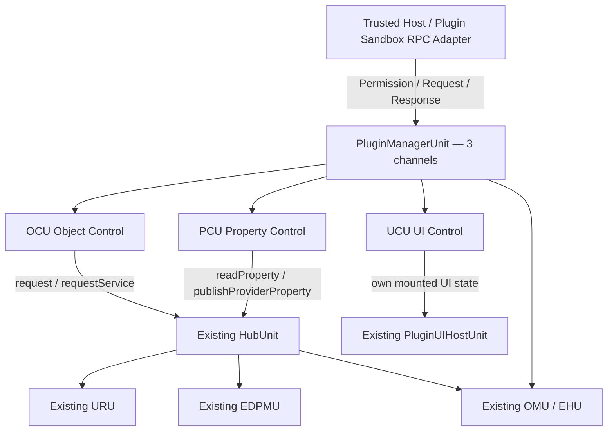

# PR23.1 — Architecture Design

## Four parts per unit
| Unit | Registrar | Bridge | Permission Manager | API Forwarder |
|---|---|---|---|---|
| OCU | URU Provider lookup | LinkCore.request / requestService | PluginPermissionUnit + Hub ACL | OCU.dispatch |
| PCU | URU Provider lookup | readProperty / publishProviderProperty | PluginPermissionUnit + EDPMU ownership | PCU.dispatch |
| UCU | URU Provider + mounted UI lookup | existing PluginUIHostUnit view operations | Provider enabled state + optional Capability | UCU.dispatch |

The PMU has no duplicate mutable Provider Registry. Host-owned UI views remain in PluginUIHostUnit.

## Message contract (v1)
Permission Request: `{permission}`.
Permission Response: `{ok,status,value:{granted,requiresHostApproval}}` or denied.
API Request: `{unit:"OCU"|"PCU"|"UCU",action,...}`.
API Response: `{ok,status,value?,error?}`.
Asynchronous Response: `{requestId,value}` must match a host-issued, unexpired, one-time pending ID.

## Security
- No untrusted caller-supplied source or origin. Bind these by trusted integration, never pass PMU itself to a sandbox.
- No permission grant via permission-request payload; no silent escalation.
- Reject cross-provider response IDs and repeated completions.
- Check live Provider state for every OCU/PCU/UCU dispatch; HubUnit retains full API/ACL checks.
- Response and catalog metadata are not capability tokens.
- PluginUIHostUnit retains opaque sandbox and DOM authority.
- Existing model: internal host could mutate through other LinkCore methods; PMU does not weaken it.

## Event Chain / EHU
- Permission: PMU.Permission -> PluginPermissionUnit (optional trusted grant).
- OCU: PMU.Request.OCU -> HubUnit.request/Service -> Scheduler -> Object.receive -> Hub OMU Log/EHU.
- PCU: PMU.Request.PCU -> HubUnit.readProperty/publishProviderProperty -> EDPMU.
- UCU: PMU.Request.UCU -> existing PluginUIHostUnit mounted view.
- Async REP: PMU.Response -> pending ID + owner + TTL check -> callback -> OMU.
Failures produce PMU EHU with status; successful actions retain the existing Hub audit chain.

## Explicit boundary
PMU v1 is an additive host-side adapter, not a complete universal UI Host or fully exposed Plugin SDK. No mutation to HubUnit's source or runtime internals is required.
