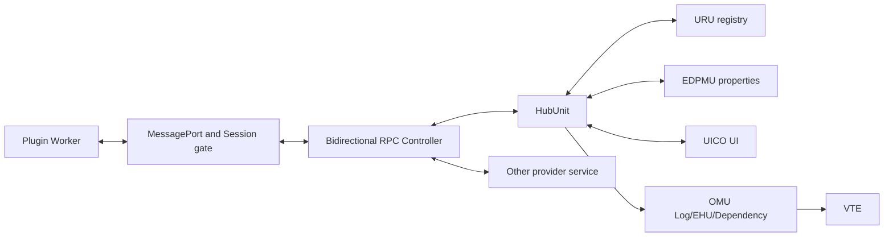

# PR24 ArcD — Dual RPC and Plugin SDK

Status: DRAFT / Partial implementation.

## New properties and objects
- PluginBidirectionalEnvelopePolicy: pure Property algorithm for
  transport-neutral validation; no independent registry.
- Planned PluginSession Object: trusted port identity and lifecycle.
- Planned PluginRPCController Object: request map and fair scheduling.
- Planned PluginSDK facade: plugin-facing isolated API.

## Chains
| Event chain | Sequence | Gate |
| --- | --- | --- |
| EC24-01 | Plugin → envelope → trusted port → Hub → Host | ACL |
| EC24-02 | Host → controller → port → Plugin → response | session |
| EC24-03 | Plugin A → Hub → URU → Plugin B | capability |
| EC24-04 | Plugin → UICO → UISP → native adapter | UI ACL |
| EC24-05 | Revoke → session abort → pending settle | fail closed |
| EC24-06 | Plugin crash → EHU → cleanup → restart | no leak |
| EC24-07 | Host deadline → abort → EHU 504 → Worker | stale reply suppressed |
| EC24-08 | Package RPC scope declaration → user consent → Host gate → Hub | exact Object/Action ACL |
| EC24-09 | Host-scope Property.Read → Hub.readProperty → EDPMU | exact Property and visibility ACL |

## EHU audit schema
requestId, eventId, parentEventId, sessionId, providerId, source
ObjectId, target ObjectPath, action, status, errorCode, elapsedMs.
OMU must log failures without cooldown; eligible duplicate successes
may be coalesced for 1 second. No secrets or raw payload dumps.

## Boundary invariant
Untrusted Worker input is data, not authoritative source identity.
Only MessagePort-owned session metadata can bind source/provider/Object.
The envelope policy validates shape; session/ACL/HubUnit must authorize.
No response may be accepted without matching an outstanding request,
direction, session and deadline.

## Patch(+8) deadline and rotation
A trusted Host transport sends a bounded, contract-validated 504
`RPC_TIMEOUT` message using a fresh OMU eventId at deadline expiry.
The asynchronous Hub request may still be running if its Object ignores
AbortSignal; transport retains its concurrency slot until it settles,
then suppresses the stale response. Revocation/suspension removes the
MessagePort listener and aborts all outstanding signals. No cross-session
response is eligible for delivery after a rekey.

## PR24 Patch(+9) Scope and trust boundary
The package-level `rpcScopes` metadata is validated by
`PluginRPCScopePolicy` but cannot self-authorize a Session. The UI
shows requested Object/Action/Property scope entries before explicit
user consent. PluginHostInstallUnit compares requested scopes with the
host-approved set at install and upgrade (before old state teardown).
PluginSandboxBridge passes the approved frozen data to a host-private
Gateway; the Worker cannot edit this data. Gateway denies any unscoped
request before Hub dispatch with a correlated EHU, then checks the
original URU, PluginPermission and HubUnit gates. For scoped Property
reads, Gateway delegates only to HubUnit.readProperty. No arbitrary
HubUnit action, privileged Property write or direct EDPMU access is
exposed. Post-dispatch session and live grant checks are retained.

## PR24 Patch(+10) — live scope revocation event chains
| Chain | Steps | Invariant |
| --- | --- | --- |
| EC24-10 | Plugin Manager → HostInstaller.revokeRpcScope → Bridge → Transport → Gateway | Host-only; no Worker right to grant/revoke |
| EC24-11 | Gateway scope removal → abort matching controllers → OMU EHU 403 → typed response | No other route affected |
| EC24-12 | Late Host completion → Gateway scope recheck → EHU 499 → no stale response | No leaked data after revoke |
| EC24-13 | Disable → session revoke → re-enable/rekey → Gateway active snapshot | Removed scope stays removed |

### Event/log ownership
- `Plugin.Install.RPCScopeRevoked` (Host Installer, Log 200)
  captures the host user's revocation operation.
- `RPC.ScopeRevoked` (Gateway, Log 200) captures the exact
  Object/Action/Property gate update without logging request payloads.
- `RPC.ScopeRevokedInflight` (Transport, EHU 403, requestId) is
  generated for each canceled in-flight request; it owns eventId for
  the Worker-visible 403 `RPC_SCOPE_REVOKED` envelope.
- `RPC.DiscardedAfterRevoke` (Gateway, EHU 499) applies to late
  noncooperative Host completions, including after Session renewal.

### Boundaries
URU remains the Provider identity authority, HubUnit retains action
and Property ACLs, and EDPMU retains shared Property values. Scope
state stays exclusively inside the trusted Bridge's Gateway. An
aborted request may already have caused a Host side effect; no
transaction rollback is asserted. No new public Host API or alternate
permission registry is added.

## PR24 Patch(+11) — durable deny and lifecycle chains
| Chain | Stages | Authority / invariant |
| --- | --- | --- |
| EC24-14 | Host Manager revoke → Gateway revoke → deny-store.put | No plugin self-grant; storage failure disables Provider |
| EC24-15 | Reload → new HostInstaller → deny-store.getAll → filtered scopes → Gateway | Removed route cannot silently reappear |
| EC24-16 | Scope store unavailable → EHU 503 → block scoped bootstrap | Fail closed before untrusted code starts |
| EC24-17 | Upgrade request → Hub providerInflight + Bridge reverse count → 409 if busy | Never tear down an active reverse request |
| EC24-18 | Worker replacement fails → restore original URU/permissions/UI → rekey Session | Existing Bridge and grants only; no new capability |

**New internal component:** `PluginRPCRevocationStoreUnit` owns
IndexedDB deny-only metadata, not runtime positive authority.
`PluginHostInstallUnit` evaluates denied scopes before code bootstrap.
`PluginHostRequestGateway` remains sole active reverse scope gate.
`PluginSandboxBridge.pendingHostRequestCount()` counts Host→Worker
pending calls and active Plugin→Host transport reservations.
When a Host method ignores AbortSignal, its in-flight reservation
remains active until completion; upgrades cannot force safe rollback
of side effects that have already occurred.
