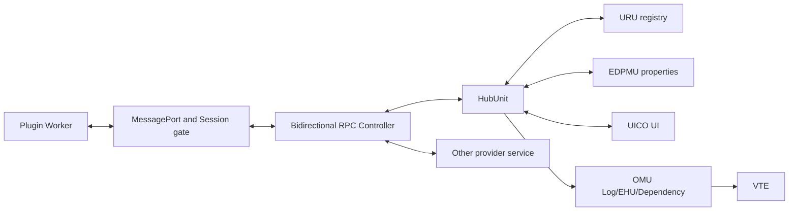

# PR24 ArcD — Dual RPC and Plugin SDK

Status: DRAFT / Partial implementation.

## New properties and objects
- PluginBidirectionalEnvelopePolicy: pure Property algorithm for
  transport-neutral validation; no independent registry.
- Planned PluginSession Object: trusted port identity and lifecycle.
- Planned PluginRPCController Object: request map and fair scheduling.
- Planned PluginSDK facade: plugin-facing isolated API.

## Chains
| Event chain | Sequence | Gate |
| --- | --- | --- |
| EC24-01 | Plugin → envelope → trusted port → Hub → Host | ACL |
| EC24-02 | Host → controller → port → Plugin → response | session |
| EC24-03 | Plugin A → Hub → URU → Plugin B | capability |
| EC24-04 | Plugin → UICO → UISP → native adapter | UI ACL |
| EC24-05 | Revoke → session abort → pending settle | fail closed |
| EC24-06 | Plugin crash → EHU → cleanup → restart | no leak |

## EHU audit schema
requestId, eventId, parentEventId, sessionId, providerId, source
ObjectId, target ObjectPath, action, status, errorCode, elapsedMs.
OMU must log failures without cooldown; eligible duplicate successes
may be coalesced for 1 second. No secrets or raw payload dumps.

## Boundary invariant
Untrusted Worker input is data, not authoritative source identity.
Only MessagePort-owned session metadata can bind source/provider/Object.
The envelope policy validates shape; session/ACL/HubUnit must authorize.
No response may be accepted without matching an outstanding request,
direction, session and deadline.
