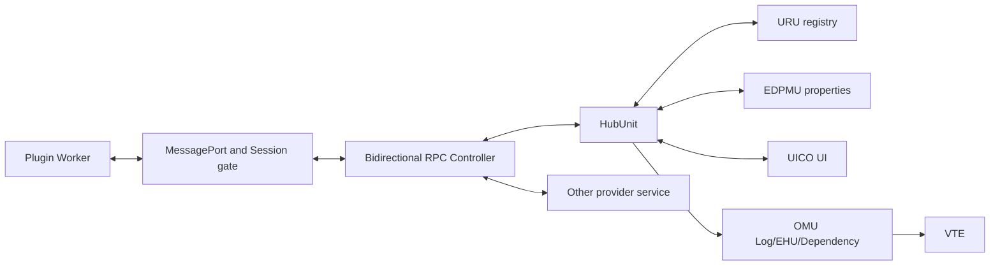

# PR24 ArcD — Dual RPC and Plugin SDK

Status: DRAFT / Partial implementation.

## New properties and objects
- PluginBidirectionalEnvelopePolicy: pure Property algorithm for
  transport-neutral validation; no independent registry.
- Planned PluginSession Object: trusted port identity and lifecycle.
- Planned PluginRPCController Object: request map and fair scheduling.
- Planned PluginSDK facade: plugin-facing isolated API.

## Chains
| Event chain | Sequence | Gate |
| --- | --- | --- |
| EC24-01 | Plugin → envelope → trusted port → Hub → Host | ACL |
| EC24-02 | Host → controller → port → Plugin → response | session |
| EC24-03 | Plugin A → Hub → URU → Plugin B | capability |
| EC24-04 | Plugin → UICO → UISP → native adapter | UI ACL |
| EC24-05 | Revoke → session abort → pending settle | fail closed |
| EC24-06 | Plugin crash → EHU → cleanup → restart | no leak |
| EC24-07 | Host deadline → abort → EHU 504 → Worker | stale reply suppressed |
| EC24-08 | Package RPC scope declaration → user consent → Host gate → Hub | exact Object/Action ACL |
| EC24-09 | Host-scope Property.Read → Hub.readProperty → EDPMU | exact Property and visibility ACL |

## EHU audit schema
requestId, eventId, parentEventId, sessionId, providerId, source
ObjectId, target ObjectPath, action, status, errorCode, elapsedMs.
OMU must log failures without cooldown; eligible duplicate successes
may be coalesced for 1 second. No secrets or raw payload dumps.

## Boundary invariant
Untrusted Worker input is data, not authoritative source identity.
Only MessagePort-owned session metadata can bind source/provider/Object.
The envelope policy validates shape; session/ACL/HubUnit must authorize.
No response may be accepted without matching an outstanding request,
direction, session and deadline.

## Patch(+8) deadline and rotation
A trusted Host transport sends a bounded, contract-validated 504
`RPC_TIMEOUT` message using a fresh OMU eventId at deadline expiry.
The asynchronous Hub request may still be running if its Object ignores
AbortSignal; transport retains its concurrency slot until it settles,
then suppresses the stale response. Revocation/suspension removes the
MessagePort listener and aborts all outstanding signals. No cross-session
response is eligible for delivery after a rekey.

## PR24 Patch(+9) Scope and trust boundary
The package-level `rpcScopes` metadata is validated by
`PluginRPCScopePolicy` but cannot self-authorize a Session. The UI
shows requested Object/Action/Property scope entries before explicit
user consent. PluginHostInstallUnit compares requested scopes with the
host-approved set at install and upgrade (before old state teardown).
PluginSandboxBridge passes the approved frozen data to a host-private
Gateway; the Worker cannot edit this data. Gateway denies any unscoped
request before Hub dispatch with a correlated EHU, then checks the
original URU, PluginPermission and HubUnit gates. For scoped Property
reads, Gateway delegates only to HubUnit.readProperty. No arbitrary
HubUnit action, privileged Property write or direct EDPMU access is
exposed. Post-dispatch session and live grant checks are retained.

## PR24 Patch(+10) — live scope revocation event chains
| Chain | Steps | Invariant |
| --- | --- | --- |
| EC24-10 | Plugin Manager → HostInstaller.revokeRpcScope → Bridge → Transport → Gateway | Host-only; no Worker right to grant/revoke |
| EC24-11 | Gateway scope removal → abort matching controllers → OMU EHU 403 → typed response | No other route affected |
| EC24-12 | Late Host completion → Gateway scope recheck → EHU 499 → no stale response | No leaked data after revoke |
| EC24-13 | Disable → session revoke → re-enable/rekey → Gateway active snapshot | Removed scope stays removed |

### Event/log ownership
- `Plugin.Install.RPCScopeRevoked` (Host Installer, Log 200)
  captures the host user's revocation operation.
- `RPC.ScopeRevoked` (Gateway, Log 200) captures the exact
  Object/Action/Property gate update without logging request payloads.
- `RPC.ScopeRevokedInflight` (Transport, EHU 403, requestId) is
  generated for each canceled in-flight request; it owns eventId for
  the Worker-visible 403 `RPC_SCOPE_REVOKED` envelope.
- `RPC.DiscardedAfterRevoke` (Gateway, EHU 499) applies to late
  noncooperative Host completions, including after Session renewal.

### Boundaries
URU remains the Provider identity authority, HubUnit retains action
and Property ACLs, and EDPMU retains shared Property values. Scope
state stays exclusively inside the trusted Bridge's Gateway. An
aborted request may already have caused a Host side effect; no
transaction rollback is asserted. No new public Host API or alternate
permission registry is added.

## PR24 Patch(+11) — durable deny and lifecycle chains
| Chain | Stages | Authority / invariant |
| --- | --- | --- |
| EC24-14 | Host Manager revoke → Gateway revoke → deny-store.put | No plugin self-grant; storage failure disables Provider |
| EC24-15 | Reload → new HostInstaller → deny-store.getAll → filtered scopes → Gateway | Removed route cannot silently reappear |
| EC24-16 | Scope store unavailable → EHU 503 → block scoped bootstrap | Fail closed before untrusted code starts |
| EC24-17 | Upgrade request → Hub providerInflight + Bridge reverse count → 409 if busy | Never tear down an active reverse request |
| EC24-18 | Worker replacement fails → restore original URU/permissions/UI → rekey Session | Existing Bridge and grants only; no new capability |

**New internal component:** `PluginRPCRevocationStoreUnit` owns
IndexedDB deny-only metadata, not runtime positive authority.
`PluginHostInstallUnit` evaluates denied scopes before code bootstrap.
`PluginHostRequestGateway` remains sole active reverse scope gate.
`PluginSandboxBridge.pendingHostRequestCount()` counts Host→Worker
pending calls and active Plugin→Host transport reservations.
When a Host method ignores AbortSignal, its in-flight reservation
remains active until completion; upgrades cannot force safe rollback
of side effects that have already occurred.

## PR24 Patch(+12) — generic SDK and runtime controls

| Chain | Dispatch / audit | Invariant |
| --- | --- | --- |
| EC24-19 | Third-party Worker → Cluster.request → Session → Gateway → HubUnit → second Provider Worker | Exact scope plus URU and HubUnit ACL |
| EC24-20 | Host → BidirectionalRPCController → same Port → Worker handler → audited Host reply | Worker eventId never authoritative |
| EC24-21 | Plugin Manager confirms reapproval → suspend Session → reviewed grant → durable denial clear → new Session | No uncommitted rights exposed to Worker |
| EC24-22 | IndexedDB denial commit → BroadcastChannel → receiver re-reads store → live Gateway revoke | Only deny may cross tab, never a grant |
| EC24-23 | Third timeout in rolling 60s → Transport circuit open → EHU 503 → Host reset | Bounded in-flight and explicit reset |
| EC24-24 | Worker crash → Bridge terminate/close Port → live Provider disabled → UI unavailable | No unrelated plugin affected |
| EC24-25 | Third-party html/uiEntry → sandbox iframe → generic Provider workbench tab | No plugin main-page DOM access |

New components:
- `PluginRPCCircuitPolicy` — pure timeout-window helper, **not**
  EDPMU Property or Provider capability.
- Ambient `Cluster` Worker SDK — plugin-facing, narrow contract;
  handler names must already be declared by URU Provider Manifest.
- `PluginWorkbenchTabUnit` — Host-owned generic tab controller,
  one Provider ID per tab; no plugin DOM object may mutate Host tabs.
- `PluginBidirectionalRPCController` — trusted Host session,
  request correlation and cancellation for Host→Plugin traffic.

Trust boundary:
- Untrusted Worker responses contain an eventId placeholder.
  PluginSandboxBridge validates the outstanding request/session,
  records a fresh OMU eventId and only then settles Host Controller.
- Scope reapproval is Host/UI-only and revocation-persistence
  dependent. Broadcasts can only cause further denial; no implicit
  permission or automatic cross-tab regrant.
- Plugin UI remains an opaque-origin iframe. Internal tab styling
  is controlled by the plugin's own sandboxed HTML, while the
  native workbench tab is owned/removed by Host only.
- An ignored AbortSignal may leave Host side effects behind.
  Breaker prevents new dispatch; it does not undo previous effects.

| EC24-26 | Third-party Worker → Cluster.request(UICO.uiRequest) → HubUnit → UICO → owner-scoped native Button/Window/Tab | Exact rpcScope + per-action capability + URU identity + automatic teardown |

## PR24 Patch(+13) — audit and UI Event Chains
| Chain | Route | Guarantee |
| --- | --- | --- |
| EC24-27 | Worker response → Bridge Session preflight → OMU correlated Log → Controller.receive | Unique requestId always yields unique Host Event ID; no 1s cooldown |
| EC24-28 | OMU audit unavailable → Bridge EHU 503 + cancel → pending Host caller settles 499 | No uncaught null.eventId / silent 504 |
| EC24-29 | Third-party UICO.uiRequest → fixed slot resolution → visible native header Button | Host owns selector, DOM, ACL and teardown |
| EC24-30 | Four consecutive Host RPC calls → Hub/Controller → Worker → distinct OMU events | Catch rapid sequential reply loss |

The Event ID is generated only by OMU. A Worker eventId
placeholder never establishes Host authority. The OMU cooldown
still applies to uncorrelated success entries; correlated success
entries bypass it without adding request IDs to the PASS cooldown map,
avoiding unbounded key accumulation.

## PR24 Patch(+14): multi-Port Event Chains

| Chain | Trace | Expected security result |
| --- | --- | --- |
| EC24-31 | URU owner → Gateway.create → Port A/B Session IDs → independent request/replay | Same Provider may own multiple Ports; unique Session IDs |
| EC24-32 | Foreign Provider → already pinned Gateway.create | 403 and OMU EHU RPC.ForeignProviderRejected |
| EC24-33 | Old Host Port detached → new Host Gateway owner/session → old route request | Explicit 403; no inherited old scopes or identity |
| EC24-34 | Port A+B Slow RPC → Gateway live revoke → Transport cancel per Port | Two correlated 403 responses and no stale Host payload |
| EC24-35 | Two active Ports → unaffected Fast requests → Host settles aborted Slow calls | Fast succeeds; inflight reservations reach zero; Sessions retained |

Changes: `PluginHostRequestGateway` adds Host-private
`#ownerProviderId` and `#ownerObjectId`; first successful
`create(port, providerId)` permanently pins its owner. No
new URU Provider, EDPMU Property or plugin-facing API.
Source evidence: `Implementation/tests/pr24-multi-session-vte.test.js`
uses real Node MessagePorts and an isolated core/OMU harness.

## PR24 Patch(+15): fault/backoff EventChain

| Chain | Steps | Security invariant |
| --- | --- | --- |
| EC24-36 | Isolated Worker exception → Bridge.terminate → Host onFault → URU disable → RestartCircuitPolicy.fault → OMU EHU | Only live owner Provider is disabled; only Host records a fault |
| EC24-37 | Explicit install → consent/review → per-Provider restart status → 429 or bootstrap | Uninstall cannot reset a cooling Provider |
| EC24-38 | Explicit Host-confirmed restart reset → clear memory history → OMU Log | Worker cannot bypass lock through RPC |
| EC24-39 | Provider A circuit open → unrelated Provider B install | No global lock; independent Provider survives |

`PluginRestartCircuitPolicy` is a pure policy module in
`Implementation/property`. `PluginHostInstallUnit.restartFaults`
is Host-private lifecycle state, **not** an EDPMU Property, URU
Provider, persisted positive authorization, or Plugin SDK method.
