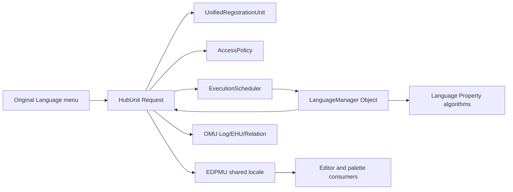

# PR3 Architecture Design — Patch(+1)

## Object: LanguageManager
- Request/Response: get / set / translate
- User API: get / set / translate
- Agent API: get / translate (read-only)
- Property: Language
- Program: restore, persistence, snapshots, DOM-notification callback
- EHU/Log: OMU via HubUnit; 400 invalid, 403 unauthorized,
  503 persistent storage unavailable, 200 successful change

## Property: Language
- Shared value: `"zh-Hant" | "en"`, registered by LinkCore.
- Pure algorithm: Language.valid(locale), Language.translate(locale,key,args).
- Catalog: immutable, one key hierarchy per supported locale.
- Add future locales by extending catalog, not modifying HubUnit logic.
- Protected/Private object logic remains governed by AccessPolicy;
  Language is intentionally Public.

## Event Chains
1. UI clicks locale → HubUnit.Request → URU lookup and UserAPI check
   → scheduler FIFO → LanguageManager.Response(set)
   → Language.valid → HubUnit.publishProperty
   → EDPMU(Language) → OMU Log/Dependency → UI texts update.
2. Invalid locale → Language.valid FAIL → EHU 400 → no mutation.
3. Agent attempts set → HubUnit AgentAPI rejection → EHU 403.
4. Page reload → URU empties → LinkCore registers default Language
   → LanguageManager.restore → HubUnit publishes stored locale
   → UI binds translations and DocumentStatus.
5. File close confirmation → FileWorkspace reads shared Language
   through LinkCore/HubUnit, then resolves Language.translate locally.

## Mermaid

## Property publication and isolation
- LanguageManager is the single writer of shared locale value.
- Editor, FileWorkspace, and Palette consume same locale.
- Language choice is serialized, file operations can overlap.
- UI-local repaint callback does not itself mutate a Property.
- All inter-object state requests use HubUnit.
