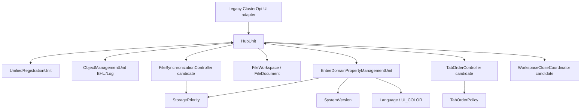

# PR4 ArcD — Patch(+1): candidate architecture (not implemented)

## Reuse and object boundaries
Existing: MainUI adapter; FileWorkspace; FileDocument; LanguageManager; InterfacePalette;
LinkCore consisting of HubUnit, ObjectManagementUnit, EntireDomainPropertyManagementUnit,
UnifiedRegistrationUnit. Preserve current working PR1–PR3 features.

Candidate additions (new files only after checking global registry):
- Object TabOrderController: Request/Response reorder; single-writer ordered document IDs.
- Object FileSynchronizationController: Request/Response observeExternal, reconcile; access to file handles scoped to existing FileDocument.
- Property StoragePriority: enum ExternalFirst | InternalFirst, shared via EDPMU.
- Property TabOrderPolicy: input validation/algorithm separated from object I/O.
- Object WorkspaceCloseCoordinator: Request closeAll, prompts safety checks and calls FileWorkspace close per document.

Avoid introducing a new Object where FileWorkspace already owns the behavior; decide at implementation patch and record why.
All shared properties are centrally defined and managed; no copy of Language/UI_COLOR/SystemVersion.

## OCDA contract for every new Object
Object EHU/Log; Request; Response; User API; Agent API; Property; Program.
Use Public / Protected / Private access declarations explicitly.
SubObject path uses Object.SubObject, inherited properties obey isolation.
No SendTo(): route cross-object operations through ObjectPath.Request.Action (HubUnit implementation).

## Event Chains (design targets)
E1: User Close All → MainUI Request → HubUnit → URU → WorkspaceCloseCoordinator →
FileWorkspace close checks → FileDocument unregister → OMU PASS/FAIL → UI render.
E2: User drag tabs → MainUI Request → HubUnit → TabOrderController →
TabOrderPolicy.validate → FileWorkspace reorder → OMU dependency/log → UI render.
E3: Policy change → MainUI Request → HubUnit → StoragePriority owner →
EDPMU publish shared property → all consumers.
E4: External file mutation → FileSynchronizationController Request →
HubUnit → FileDocument reconciliation using StoragePriority →
OMU and UI status. No silent dirty overwrite.
E5: Missing registered Object → HubUnit URU registration attempt → EHU FAIL to OMU if unsuccessful.
E6: reload → clear URU runtime registry → LinkCore publishes SystemVersion →
objects re-register; independently restore supported persisted preferences.

## Relationship codes
00 = no interaction; 10 = source Request only; 01 = source Response only;
11 = bidirectional. Interpret codes from each declared directed edge, not from
mere property sharing. Verify relation dynamically with VTE test paths.

## EHU checklist
- 200 PASS: successful operation; repetitive same-source/event PASS may be filtered within 1s.
- 400 FAIL: invalid action, order index, or policy.
- 403 FAIL: denied caller/permission.
- 404 FAIL: missing Object/handle/file.
- 409 FAIL: external conflict or stale file revision.
- 500 FAIL: unexpected implementation error.
- 503 FAIL: browser feature/storage unavailable.
Never throttle FAIL or EHU itself; preserve event chain IDs.

## Parallelization
HubUnit handles routing and records all requests/responses/property traffic.
Single document operations: serialize by document ID.
Different documents: independent tasks may overlap.
Long-running external-sync tasks: abort signal and bounded scheduling.
Algorithms belong to Property; Object defines API, ownership and lifecycle.

## Abstract structure

## Current implementation state
This document defines candidate work; it does not certify new Objects, properties, relations or tests as implemented.

## Patch(+2) implemented event chains
Close All: UI → HubUnit(Request.closeAll) → FileWorkspace.Response.closeAll
→ Language.confirmCloseAll → unregister FileDocument* → OMU events → UI.
Cancellation returns false, leaves registration and text unchanged.
Reorder: Native tab drag/drop → UI → HubUnit(Request.reorder)
→ FileWorkspace.Response.reorder → documents.splice → UI.
Object: existing FileWorkspace; property: existing Language.
Relation: UI -> Workspace request 10; Workspace -> UI response 01;
combined pair 11. Invalid indices produce EHU 400 from Workspace.
No new shared Property in this patch.

## Patch(+3) StoragePriority
New Property: `StoragePriority` (`external` / `internal`), Public.
Existing Object FileWorkspace: Request/Response setPriority, syncExternal;
FileDocument: Request/Response reconcile. New algorithm file:
Implementation/property/StoragePriority.js.
Event Chain: UI -> HubUnit -> FileWorkspace.setPriority ->
HubUnit.publishProperty -> EDPMU -> UI.
Event Chain: timer/focus -> HubUnit -> FileWorkspace.syncExternal ->
parallel FileDocument.reconcile -> getFile metadata -> either load
(ExternalFirst) or retain local dirty text (InternalFirst) -> UI.
Event Chain: save -> HubUnit -> workspace -> Document.reconcile ->
Document.save only if external policy did not replace local draft.
Failure/status: 400 invalid priority, 403 API denial, 404 missing
registration/handle, 500 read/write error, 503 preference storage.
No independent manager object created for storage since FileWorkspace already
owns file coordination. HubUnit remains the inter-object route.

## Patch(+4) UI adapter update
No new Object or shared Property: MainUI binds legacy DOM and
LanguageManager translates the original menu and priority selector.
Event: User selects #priority -> MainUI -> HubUnit.Request.setPriority ->
FileWorkspace.Response.setPriority -> EDPMU.StoragePriority -> render.
Event: User selects either Close All entry -> HubUnit -> FileWorkspace
closeAll -> OMU/EHU -> render. Both buttons are the SAME action.
Disabled future entries perform no Request and modify no Property.
All legacy style rules remain in clusteropt-legacy.css.
