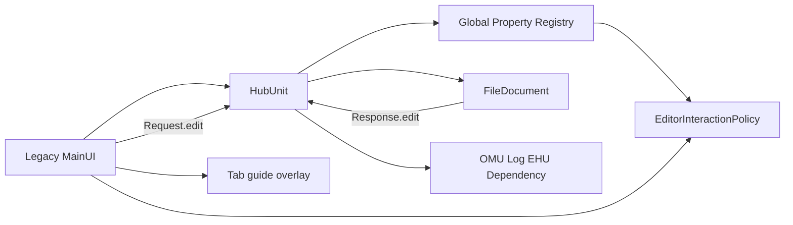

# PR5 ArcD — Patch(+1): Editor Interaction

## Objects
- Existing MainUI: accepts user keyboard input, applies policy edit to
  textarea, dispatches Input and sends HubUnit.Request.edit.
- Existing FileDocument: performs edit Response and increments revision.
- Existing FileWorkspace: manages active window, tabs and render.
- Existing HubUnit / URU / OMU / EDPMU: route, register and log.

## New shared Property
EditorInteractionPolicy (immutable Public Property), in
Implementation/property/EditorInteractionPolicy.js.
Defined algorithms: transform and guideWindow.
Owners: LinkCore. Public consumers: UI / future editor plugin.
No new cross-object direct write path.

## Event Chains
E1: User keydown -> MainUI reads global policy via registered HubUnit
-> EditorInteractionPolicy.transform -> textarea.setRangeText ->
Input event -> HubUnit.request(ui, document-X, edit) ->
FileDocument.Response.edit -> OMU Log + Dependency -> MainUI status.
E2: User scroll -> MainUI requestAnimationFrame (coalesced) ->
EditorInteractionPolicy.guideWindow -> #tabGuide viewport projection.
E3: Unsupported keys / IME -> native browser input -> existing
HubUnit edit pipeline; no keydown suppression.
E4: Invalid event or denied edit -> HubUnit EHU 400/403/500, no
unauthorized mutation; existing UI error status handles failures.

## Relationship
MainUI -> FileDocument Request=10; FileDocument -> MainUI Response=01,
combined=11. Property is Public, no new parent/child isolation.
No SendTo; route uses the existing HubUnit facade.

## EHU
200 PASS: delivered edit, response.
400 FAIL: invalid edit argument, bad object contract.
403 FAIL: unauthorized Agent/User API.
404 FAIL: missing registered target.
500 FAIL: transformation/IO or response failure.
Log pass de-dup inherited OMU rules; never throttle FAIL or EHU.

## Performance and parallel execution
Single file editing serializes by per-document HubUnit scheduler key.
Tab guides update independently on requestAnimationFrame; unrelated
file activities may overlap. No synchronous whole-document syntax
highlighting or DOM construction for each scroll event.

## Abstract architecture

## Incremental guide anchor
MainUI retains a non-persistent, view-only {firstLine,offset} anchor.
A text edit or tab switch invalidates it; only guideWindow() uses it
and it has no effect on text or file state. No new Object is needed.

## Native undo event path
MainUI transforms key -> native insertText (Chromium, if supported) ->
browser Input -> HubUnit Request.edit -> FileDocument; fallback uses
setRangeText + synthetic Input. No internal history manager or new Object.
The browser maintains native edit history on the preferred path.
The fallback has weaker undo guarantees; test browsers before PR5 PASS.
